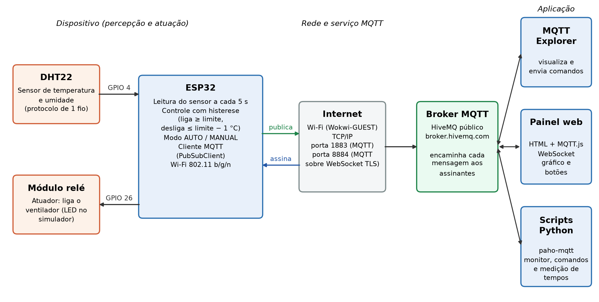
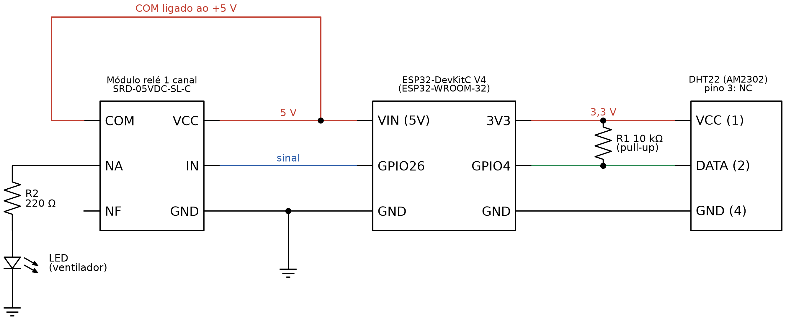
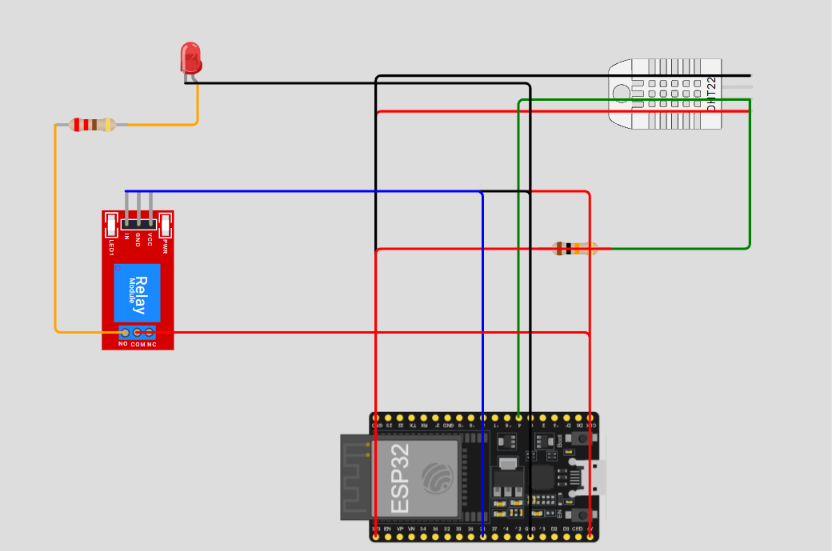
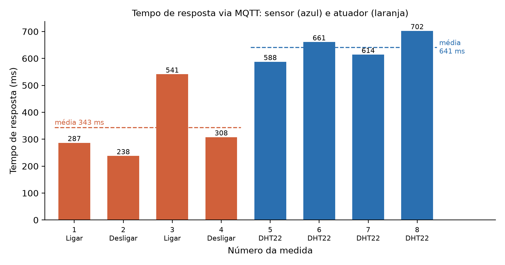

# Sistema IoT de Monitoramento e Controle Automático de Temperatura Ambiente com ESP32 e Protocolo MQTT

Protótipo de Internet das Coisas (IoT) que mede a **temperatura** e a **umidade relativa** de um ambiente com um sensor **DHT22**, liga automaticamente um **ventilador** por meio de um **módulo relé** quando a temperatura passa de um limite configurável e publica tudo na Internet pelo protocolo **MQTT**. Pelo mesmo protocolo, o usuário acompanha as leituras e envia comandos (ligar, desligar, modo automático e novo limite) de qualquer lugar.

Trabalho final da disciplina de Internet das Coisas, Universidade Presbiteriana Mackenzie.
Autora: **Julia Sydor**. Orientador: **Prof. André Luis de Oliveira**.

| | |
|---|---|
| Vídeo-demonstração | _a publicar_ <!--LINK_YOUTUBE--> |
| Simulação no Wokwi | https://wokwi.com/projects/481670857769020417 |
| Artigo | _a publicar_ <!--ARTIGO--> |



---

## Sumário

1. [Como funciona](#1-como-funciona)
2. [Hardware](#2-hardware)
3. [Comunicação MQTT](#3-comunicação-mqtt)
4. [Como reproduzir](#4-como-reproduzir)
5. [Scripts e painel](#5-scripts-e-painel)
6. [Medição dos tempos de resposta](#6-medição-dos-tempos-de-resposta)
7. [Estrutura do repositório](#7-estrutura-do-repositório)
8. [Referências](#8-referências)

---

## 1. Como funciona

1. Ao ligar, o ESP32 deixa o relé desligado, inicia o DHT22 e assume **limite = 28 °C** e **modo automático**.
2. Conecta-se ao Wi-Fi e ao broker MQTT público `broker.hivemq.com:1883`. Registra uma *Last Will* (`offline`), publica `online` e assina os tópicos de comando.
3. A cada **5 s**, lê o DHT22. Leituras inválidas (falha no *checksum*) são descartadas.
4. **Modo automático com histerese de 1 °C**: liga o ventilador quando `T ≥ limite` e desliga quando `T ≤ limite − 1 °C`. Entre esses valores, o estado é mantido, o que evita que o relé fique ligando e desligando.
5. Publica temperatura, umidade, estado do ventilador, modo e limite vigente.
6. Comandos recebidos: `LIGAR` e `DESLIGAR` passam o sistema para o **modo manual**, e `AUTO` volta ao automático. Um número em `clima/limite` (10 a 50 °C) altera o limite.
7. Se o broker cair, o controle local continua funcionando e a reconexão é tentada a cada 5 s, sem bloquear o laço principal.

Fluxograma completo: [`docs/diagramas/fluxograma.png`](docs/diagramas/fluxograma.png). Detalhes do código: [`docs/software.md`](docs/software.md).

## 2. Hardware

| Item | Qtd. | Especificação | Função |
|---|---|---|---|
| ESP32-DevKitC V4 (ESP32-WROOM-32) | 1 | 2 núcleos de 240 MHz, Wi-Fi 2,4 GHz, lógica de 3,3 V | Controle e comunicação MQTT |
| DHT22 (AM2302) | 1 | −40 a 80 °C (±0,5 °C); 0 a 100 % UR (±2 %) | Sensor |
| Módulo relé de 1 canal (SRD-05VDC-SL-C) | 1 | Bobina de 5 V; contatos de 10 A em 250 V CA | Atuador |
| LED vermelho de 5 mm + resistor de 220 Ω | 1 | aprox. 14 mA | Representa o ventilador no simulador |
| Resistor de 10 kΩ | 1 | 1/4 W | Pull-up da linha de dados do DHT22 |
| Miniventilador CC de 5 V (montagem física) | 1 | 5 V | Carga real no lugar do LED |
| Protoboard, jumpers, cabo micro-USB | - | - | Montagem e alimentação |

| Componente | Pino | Ligação no ESP32 |
|---|---|---|
| DHT22 | VCC / DATA / GND | 3V3 / **GPIO 4** (+10 kΩ para 3V3) / GND |
| Relé | VCC / IN / GND | VIN (5 V) / **GPIO 26** / GND |
| Relé | COM / NA | VIN (5 V) / R 220 Ω → LED → GND |

Esquema elétrico e montagem:




O protótipo foi construído e validado no simulador **Wokwi**. Não há peças impressas em 3D nem caixa. Na montagem física, basta trocar o LED pelo miniventilador de 5 V, sem nenhuma mudança no código. Datasheets, consumo de corrente e justificativa da plataforma: [`docs/hardware.md`](docs/hardware.md).

## 3. Comunicação MQTT

- **Broker:** HiveMQ público, `broker.hivemq.com`. Porta **1883** (MQTT/TCP) para o ESP32 e os scripts, porta **8884** (MQTT sobre WebSocket com TLS, caminho `/mqtt`) para o painel web.
- **QoS 0** em todas as mensagens. As leituras se repetem a cada 5 s, então a próxima corrige uma eventual perda.
- **Payload:** texto simples. Números com uma casa decimal, como `27.4`.

| Tópico (prefixo `mackenzie/jsydor/`) | Sentido | Conteúdo |
|---|---|---|
| `clima/temperatura` | ESP32 → broker | temperatura em °C (`27.4`) |
| `clima/umidade` | ESP32 → broker | umidade em % (`61.0`) |
| `clima/limite_atual` | ESP32 → broker | limite vigente em °C (`28.0`) |
| `ventilador/estado` | ESP32 → broker | `LIGADO` / `DESLIGADO` |
| `ventilador/modo` | ESP32 → broker | `AUTO` / `MANUAL` |
| `sistema/status` | ESP32 → broker (retida) | `online` / `offline` (*Last Will*) |
| `ventilador/comando` | broker → ESP32 | `LIGAR`, `DESLIGAR`, `AUTO` |
| `clima/limite` | broker → ESP32 | novo limite (10 a 50) |
| `diagnostico/ping` → `diagnostico/pong` | ida e volta | eco, usado para medir a latência da rede |
| `diagnostico/medir` → `diagnostico/leitura` | ida e volta | leitura imediata do sensor (JSON com `id` e `leitura_ms`) |

Documentação completa (formato das mensagens, sequência e exemplos): [`docs/mqtt.md`](docs/mqtt.md).

## 4. Como reproduzir

### 4.1 No simulador Wokwi (sem hardware)

1. Abra o link da simulação (tabela no início desta página), ou crie um projeto ESP32 em <https://wokwi.com> e copie os arquivos `firmware/sketch.ino`, `firmware/diagram.json` e `firmware/libraries.txt`.
2. Clique em **▶ Start**. No monitor serial aparecem a conexão ao Wi-Fi `Wokwi-GUEST`, a conexão ao broker e as leituras.
3. Clique no DHT22 durante a simulação e mova o controle de temperatura acima de 28 °C. O relé liga e o LED acende.

> Deixe a janela do Wokwi **visível** e use **uma só** aba com o projeto. Com a janela coberta ou minimizada, a simulação fica muito lenta e o ESP32 perde a conexão (`sistema/status = offline`). Se o ícone de Wi-Fi aparecer com um X e o monitor serial mostrar só pontos, reinicie a simulação.

### 4.2 Na placa real

1. Instale a Arduino IDE 2 e o pacote **esp32** da Espressif (Gerenciador de Placas).
2. Instale as bibliotecas **PubSubClient** (Nick O'Leary), **DHT sensor library** e **Adafruit Unified Sensor** (Adafruit).
3. Em `sketch.ino`, troque `WIFI_SSID` e `WIFI_PASSWORD` pela sua rede e, em `WiFi.begin(...)`, remova o argumento de canal `6` (específico do Wokwi).
4. Monte o circuito conforme a tabela acima, selecione a placa **ESP32 Dev Module** e grave.

### 4.3 Acompanhar e comandar

- **MQTT Explorer** (<https://mqtt-explorer.com>): em **Advanced**, troque a assinatura `#` por `mackenzie/jsydor/#` (o HiveMQ público recusa `#`) e conecte em `broker.hivemq.com:1883`. Para comandar, publique `LIGAR` em `mackenzie/jsydor/ventilador/comando`.
- **Painel web**: abra `painel/index.html` no navegador. Ele se conecta sozinho.
- **Linha de comando**: veja a seção 5.

> Para usar o seu próprio prefixo de tópicos e não misturar com outras pessoas, altere `mackenzie/jsydor` no firmware, em `scripts/config.py` e em `painel/index.html`.

## 5. Scripts e painel

```bash
cd scripts
pip install -r ../requirements.txt
python monitor_mqtt.py                 # mostra e grava (resultados/log_mqtt.csv) todas as mensagens
python enviar_comando.py LIGAR         # LIGAR | DESLIGAR | AUTO
python enviar_comando.py --limite 26.5
python medir_tempos.py                 # 4 medições do sensor e 4 do atuador -> tabela e gráfico
python gerar_graficos.py               # gráficos a partir dos CSV de resultados/
python gerar_diagramas.py              # regenera os diagramas de docs/diagramas/
```

| Arquivo | Função |
|---|---|
| `scripts/config.py` | broker, porta e tópicos usados por todos os scripts |
| `scripts/conexao.py` | conexão com o broker, com espera da confirmação (CONNACK) |
| `scripts/monitor_mqtt.py` | assina `mackenzie/jsydor/#`, imprime com horário e grava CSV |
| `scripts/enviar_comando.py` | publica comandos e limite |
| `scripts/medir_tempos.py` | mede os tempos de resposta (seção 6) |
| `scripts/gerar_graficos.py` | gera `grafico_tempos.png` e `grafico_leituras.png` |
| `scripts/gerar_diagramas.py` | gera o esquema elétrico, a arquitetura e a sequência MQTT |
| `painel/index.html` | painel web (MQTT.js sobre WebSocket + Chart.js) |

## 6. Medição dos tempos de resposta

Os relógios do computador e do ESP32 não são sincronizados, por isso todos os tempos são medidos no **mesmo relógio**: o do computador, por meio de mensagens de ida e volta.

- **Ping:** `diagnostico/ping` → ESP32 → `diagnostico/pong`. O resultado é o RTT da rede (computador ↔ broker ↔ ESP32).
- **Atuador:** publica `LIGAR` ou `DESLIGAR` e espera a confirmação em `ventilador/estado`, que o ESP32 só publica depois de comutar o relé.
  `tempo comando → relé ≈ RTT_comando − RTT_ping / 2`
- **Sensor:** publica um id em `diagnostico/medir`. O ESP32 lê o DHT22 na hora e publica a leitura com o mesmo id.
  `tempo leitura → cliente MQTT ≈ RTT_medição − RTT_ping / 2`

Resultados obtidos: [`resultados/tabela_tempos.md`](resultados/tabela_tempos.md), [`resultados/medicoes.csv`](resultados/medicoes.csv) e o gráfico abaixo.



## 7. Estrutura do repositório

```
firmware/        código do ESP32 (sketch.ino), circuito do Wokwi (diagram.json) e bibliotecas
painel/          painel web MQTT (index.html)
scripts/         monitor, comandos, medição de tempos, gráficos e diagramas (Python)
docs/            hardware.md, mqtt.md, software.md e diagramas/
resultados/      medições, logs e gráficos usados no artigo
artigo/          versão final do artigo (a publicar)
```

## 8. Referências

- OASIS. *MQTT Version 3.1.1*. 2014. <https://docs.oasis-open.org/mqtt/mqtt/v3.1.1/os/mqtt-v3.1.1-os.html>
- Espressif Systems. *ESP32 Series Datasheet*. <https://www.espressif.com/sites/default/files/documentation/esp32_datasheet_en.pdf>
- Aosong Electronics. *DHT22 (AM2302) datasheet*. <https://www.sparkfun.com/datasheets/Sensors/Temperature/DHT22.pdf>
- Songle Relay. *SRD-05VDC-SL-C datasheet*.
- O'Leary, N. *PubSubClient*. <https://github.com/knolleary/pubsubclient>
- Eclipse Foundation. *Eclipse Paho MQTT Python Client*. <https://github.com/eclipse-paho/paho.mqtt.python>
- HiveMQ. *Public MQTT Broker*. <https://www.hivemq.com/mqtt/public-mqtt-broker/>
- Wokwi. <https://wokwi.com>

Licença: MIT. Veja [LICENSE](LICENSE).
