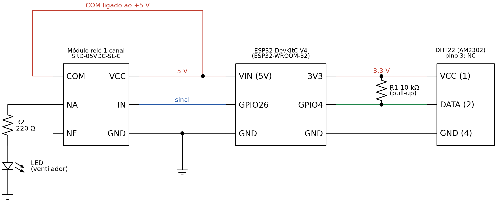
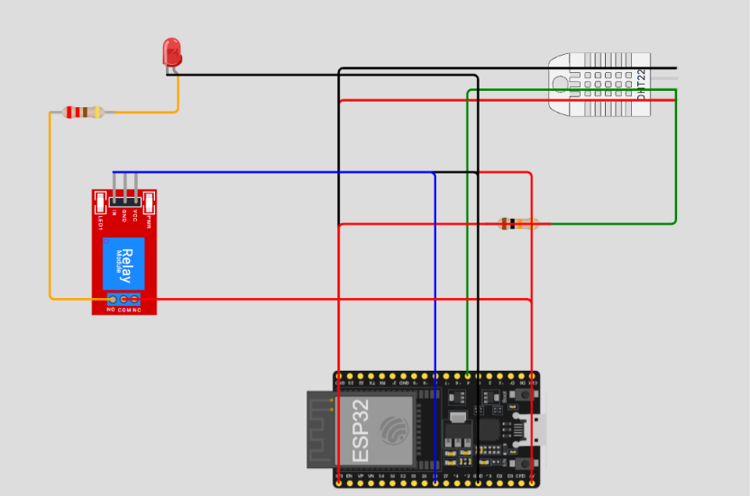

# Descrição do hardware

## Plataforma: ESP32-DevKitC V4 (módulo ESP32-WROOM-32)

- SoC ESP32 (Espressif): Xtensa LX6 de 32 bits, 2 núcleos, até 240 MHz, 520 kB de SRAM.
- Módulo WROOM-32: 4 MB de flash e antena na própria placa (PCB).
- Wi-Fi 802.11 b/g/n de 2,4 GHz e Bluetooth 4.2 (BR/EDR e BLE).
- 34 GPIO, ADC de 12 bits, 2 DAC de 8 bits, PWM, UART, SPI e I2C. Lógica de **3,3 V**.
- A placa DevKitC traz conversor USB-serial, regulador de 5 V para 3,3 V e botões EN e BOOT. Alimentação de 5 V pelo micro-USB.
- Datasheets: <https://www.espressif.com/sites/default/files/documentation/esp32_datasheet_en.pdf> e <https://www.espressif.com/sites/default/files/documentation/esp32-wroom-32_datasheet_en.pdf>

**Por que o ESP32:** tem Wi-Fi integrado, o que dispensa shield ou módulo de rede (o Arduino Uno precisaria de um). Tem mais memória e núcleos que o ESP8266 e custa e consome muito menos que um Raspberry Pi. É programado na Arduino IDE.

## Sensor: DHT22 (AM2302), Aosong Electronics

- Alimentação de 3,3 a 6 V e consumo máximo de 1,5 mA durante a medição.
- Temperatura de −40 a 80 °C (±0,5 °C). Umidade de 0 a 100 % UR (±2 %). Resolução de 0,1.
- Saída digital por protocolo de 1 fio: 40 bits por leitura, com *checksum*. Intervalo mínimo entre leituras de 2 s (o projeto usa 5 s).
- Pinos: 1 VCC, 2 DATA, 3 NC, 4 GND. Pull-up de 10 kΩ entre DATA e VCC.
- Datasheet: <https://www.sparkfun.com/datasheets/Sensors/Temperature/DHT22.pdf>

## Atuador: módulo relé de 1 canal (relé Songle SRD-05VDC-SL-C)

- Bobina de 5 V CC (aprox. 72 mA). Contatos COM, NA e NF de até 10 A em 250 V CA ou 10 A em 30 V CC.
- O módulo já tem transistor de acionamento, diodo de roda-livre e LED indicador. O GPIO 26 do ESP32 aciona a entrada IN diretamente.
- Carga: no simulador, um LED vermelho com resistor de 220 Ω (aprox. 14 mA) no contato NA. Na montagem física, um miniventilador de 5 V CC no mesmo contato. Com as devidas normas de segurança, o mesmo relé poderia comandar um ventilador de 127/220 V CA.

## Orçamento de corrente (alimentação USB de 5 V, até 500 mA)

| Componente | Corrente de pior caso |
|---|---|
| ESP32 (picos de transmissão Wi-Fi) | aprox. 240 mA |
| Bobina do relé | aprox. 72 mA |
| DHT22 | 1,5 mA |
| LED + 220 Ω | aprox. 14 mA |
| **Total** | **aprox. 330 mA** (dentro do limite da porta USB) |

## Ligações

| Componente | Pino | ESP32 |
|---|---|---|
| DHT22 | VCC | 3V3 |
| DHT22 | DATA | GPIO 4 (+ 10 kΩ para 3V3) |
| DHT22 | GND | GND |
| Relé | VCC | VIN (5 V) |
| Relé | IN | GPIO 26 |
| Relé | GND | GND |
| Relé | COM | VIN (5 V) |
| Relé | NA | resistor de 220 Ω → ânodo do LED |
| LED | cátodo | GND |

## Peças mecânicas

O protótipo foi validado no simulador Wokwi e não usa peças impressas em 3D nem caixa. Para uma montagem física, os componentes cabem em uma protoboard de 830 pontos (165 × 55 mm). Uma caixa plástica de aproximadamente 120 × 80 × 50 mm, com aberturas para o sensor e para o cabo USB, seria suficiente. O DHT22 deve ficar fora da caixa ou perto de aberturas, longe do calor do regulador da placa.
