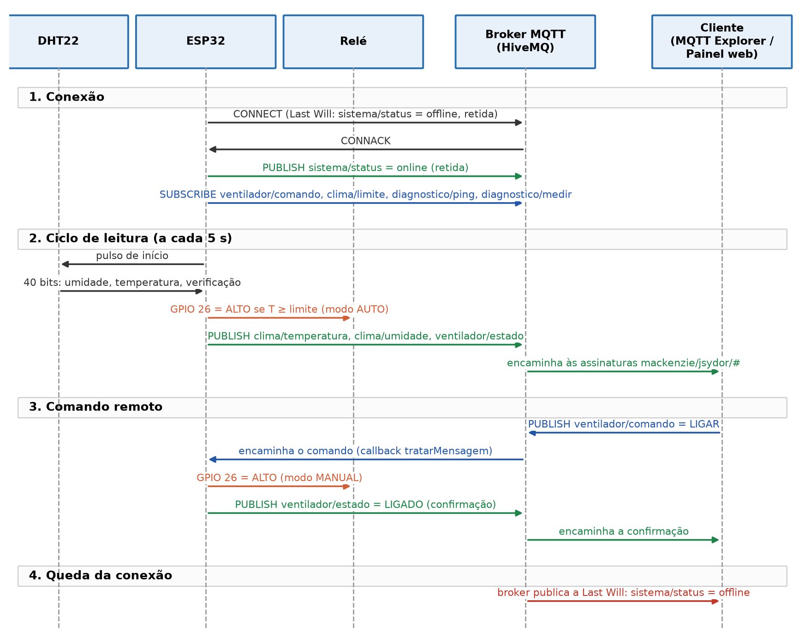

# Documentação das interfaces, protocolos e módulos de comunicação

## 1. Pilha de comunicação

| Camada | Tecnologia | Onde |
|---|---|---|
| Aplicação | MQTT 3.1.1 (publicador/assinante) | ESP32 (PubSubClient), scripts (paho-mqtt), painel (MQTT.js) |
| Transporte | TCP, porta 1883 (ESP32 e scripts) / WebSocket + TLS, porta 8884 (painel) | broker.hivemq.com |
| Rede | IPv4 (DHCP) | gateway do Wokwi / roteador |
| Enlace / físico | Wi-Fi IEEE 802.11 b/g/n, 2,4 GHz (rádio interno do ESP32) | rede `Wokwi-GUEST`, canal 6 |
| Sensor ↔ ESP32 | protocolo serial de 1 fio do DHT22 (40 bits: 16 de umidade, 16 de temperatura, 8 de verificação) | GPIO 4 |
| ESP32 ↔ atuador | saída digital (nível ALTO = relé energizado) | GPIO 26 |

O módulo de comunicação é o **rádio Wi-Fi integrado ao ESP32**. Não há Arduino, Firmata nem ponte serial-USB: o próprio microcontrolador abre a conexão TCP com o broker e fala MQTT diretamente.

## 2. Broker

- `broker.hivemq.com` (HiveMQ, público e gratuito, sem autenticação). Uso apenas didático: nenhuma informação sensível é transmitida.
- Pode ser substituído por um broker próprio (por exemplo, Eclipse Mosquitto) alterando `MQTT_BROKER` no firmware e `BROKER` em `scripts/config.py`.

## 3. Sessão do ESP32

| Parâmetro | Valor |
|---|---|
| Client ID | `esp32-jsydor-<MAC em hexadecimal>` (único por placa) |
| Keep alive | 15 s (padrão do PubSubClient) |
| Last Will | tópico `mackenzie/jsydor/sistema/status`, mensagem `offline`, QoS 0, **retida** |
| Ao conectar | publica `online` (retida) em `sistema/status`; assina `ventilador/comando`, `clima/limite`, `diagnostico/ping`, `diagnostico/medir`; publica o estado atual |
| Reconexão | a cada 5 s, sem bloquear o laço principal; se o Wi-Fi caiu, chama `WiFi.reconnect()` antes |
| QoS | 0 em todas as publicações e assinaturas |

Como a mensagem `online`/`offline` é **retida**, um cliente que se conecta depois recebe na hora o último status do dispositivo.

## 4. Tópicos e mensagens

Prefixo: `mackenzie/jsydor/`

### Publicados pelo ESP32

| Tópico | Quando | Payload | Exemplo |
|---|---|---|---|
| `clima/temperatura` | a cada leitura válida (5 s) | °C, 1 casa decimal | `27.4` |
| `clima/umidade` | a cada leitura válida | %, 1 casa decimal | `61.0` |
| `ventilador/estado` | a cada leitura e após cada comando | `LIGADO` / `DESLIGADO` | `LIGADO` |
| `ventilador/modo` | junto com o estado | `AUTO` / `MANUAL` | `AUTO` |
| `clima/limite_atual` | junto com o estado e após mudar o limite | °C, 1 casa decimal | `28.0` |
| `sistema/status` | ao conectar (`online`) ou pelo broker na queda (`offline`) | texto, retida | `online` |
| `diagnostico/pong` | ao receber um ping | mesmo conteúdo do ping | `a1b2c3d4` |
| `diagnostico/leitura` | após uma leitura pedida em `diagnostico/medir` | JSON | `{"id":"a1b2c3d4","temperatura":27.4,"umidade":61.0,"leitura_ms":31}` |

### Assinados pelo ESP32

| Tópico | Payload aceito | Efeito |
|---|---|---|
| `ventilador/comando` | `LIGAR` | modo MANUAL + liga o relé na hora |
| | `DESLIGAR` | modo MANUAL + desliga o relé na hora |
| | `AUTO` | volta ao modo automático e força uma nova leitura e decisão |
| | outro texto | ignorado (registrado no monitor serial) |
| `clima/limite` | número entre 10 e 50 | novo limite a partir da leitura seguinte; fora da faixa: ignorado |
| `diagnostico/ping` | qualquer texto | devolve o mesmo texto em `diagnostico/pong` |
| `diagnostico/medir` | um identificador | lê o DHT22 imediatamente e publica `diagnostico/leitura` |

Os comandos não diferenciam maiúsculas de minúsculas (`ligar` = `LIGAR`).

## 5. Sequência de mensagens



## 6. Exemplos com outros clientes

Mosquitto (linha de comando):

```bash
mosquitto_sub -h broker.hivemq.com -t "mackenzie/jsydor/#" -v
mosquitto_pub -h broker.hivemq.com -t "mackenzie/jsydor/ventilador/comando" -m "LIGAR"
mosquitto_pub -h broker.hivemq.com -t "mackenzie/jsydor/clima/limite" -m "26.5"
```

Python (paho-mqtt 2.x):

```python
import paho.mqtt.client as mqtt
c = mqtt.Client(mqtt.CallbackAPIVersion.VERSION2)
c.connect("broker.hivemq.com", 1883)
c.publish("mackenzie/jsydor/ventilador/comando", "AUTO")
```

Navegador (MQTT.js):

```js
const c = mqtt.connect("wss://broker.hivemq.com:8884/mqtt");
c.on("connect", () => c.subscribe("mackenzie/jsydor/#"));
c.on("message", (t, m) => console.log(t, m.toString()));
```

## 7. Segurança e limitações

- O broker público não tem autenticação nem criptografia na porta 1883, então qualquer pessoa que conheça o tópico pode ler e publicar. Para uso real: broker próprio, usuário e senha, TLS (porta 8883) e ACL por tópico.
- QoS 0 não garante a entrega dos comandos. Por isso o ESP32 confirma cada comando publicando o novo estado.
