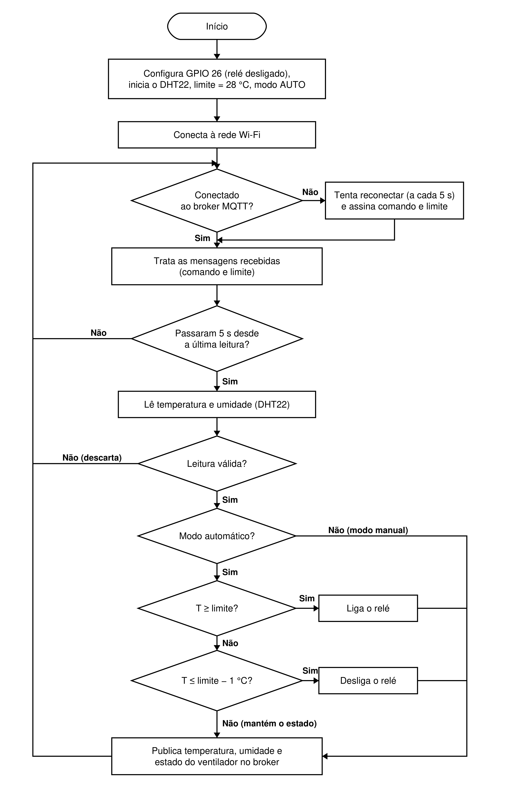

# Documentação do software (firmware do ESP32)

Arquivo: [`firmware/sketch.ino`](../firmware/sketch.ino). Linguagem C++ (framework Arduino para ESP32).

## Bibliotecas

| Biblioteca | Uso |
|---|---|
| `WiFi.h` (pacote esp32 da Espressif) | conexão à rede sem fio |
| `PubSubClient` (Nick O'Leary) | cliente MQTT 3.1.1 |
| `DHT sensor library` + `Adafruit Unified Sensor` | leitura do DHT22 |

## Constantes principais

| Constante | Valor | Significado |
|---|---|---|
| `PINO_DHT` / `PINO_RELE` | 4 / 26 | pinos do sensor e do relé |
| `INTERVALO_LEITURA_MS` | 5000 | período de leitura (o DHT22 exige ≥ 2 s) |
| `INTERVALO_RECONEXAO_MS` | 5000 | intervalo entre tentativas de reconexão ao broker |
| `HISTERESE` | 1,0 °C | desliga só quando `T ≤ limite − 1` |
| `LIMITE_MINIMO` / `LIMITE_MAXIMO` | 10 / 50 °C | faixa aceita para o limite recebido |
| `limite` (inicial) | 28,0 °C | limite de acionamento |

## Funções

| Função | Responsabilidade |
|---|---|
| `setup()` | configura o GPIO 26 em nível baixo (relé desligado), inicia o DHT22, conecta ao Wi-Fi e configura o servidor e o *callback* MQTT |
| `loop()` | `manterMqtt()` → `mqtt.loop()` (processa as mensagens recebidas) → a cada 5 s, `lerSensorEControlar()`. Nenhuma espera bloqueante |
| `conectarWiFi()` | `WiFi.begin("Wokwi-GUEST", "", 6)` e espera o IP |
| `manterMqtt()` | se desconectado, tenta a cada 5 s: registra a *Last Will*, publica `online`, assina 4 tópicos e publica o estado |
| `lerSensorEControlar()` | lê o DHT22, descarta leituras inválidas, aplica a histerese (modo AUTO), publica as leituras e o estado e, se houver pedido de medição, publica o JSON de diagnóstico |
| `acionarVentilador(bool)` | só escreve no GPIO 26 se o estado mudar e registra o evento no monitor serial |
| `publicarEstado()` | publica `ventilador/estado`, `ventilador/modo` e `clima/limite_atual` |
| `tratarMensagem(topico, payload, tamanho)` | *callback* MQTT: trata ping, comandos, limite e pedidos de medição |

## Pseudocódigo

```
INÍCIO
  relé ← DESLIGADO; limite ← 28; modo ← AUTO
  conectar Wi-Fi
  REPITA PARA SEMPRE
    SE não conectado ao broker E passaram 5 s desde a última tentativa ENTÃO
      conectar(LastWill = "offline"); publicar status "online"; assinar tópicos
    processar mensagens recebidas           ▸ tratarMensagem()
    SE passaram 5 s desde a última leitura OU há pedido de leitura ENTÃO
      (T, UR) ← ler DHT22
      SE leitura inválida ENTÃO descartar e continuar
      SE modo = AUTO ENTÃO
        SE T ≥ limite ENTÃO relé ← LIGADO
        SENÃO SE T ≤ limite − 1 ENTÃO relé ← DESLIGADO
      publicar T, UR, estado, modo, limite
FIM

tratarMensagem(tópico, msg):
  ping    → publicar msg em pong
  comando → LIGAR: modo ← MANUAL, relé ← LIGADO
            DESLIGAR: modo ← MANUAL, relé ← DESLIGADO
            AUTO: modo ← AUTO, forçar leitura
            publicar estado (confirmação)
  limite  → SE 10 ≤ msg ≤ 50 ENTÃO limite ← msg; publicar estado
  medir   → guardar id; forçar leitura imediata
```

## Fluxograma



## Registro no monitor serial

Cada evento é impresso com `millis()`. Exemplo:

```
Conectando ao Wi-Fi...... conectado. IP: 10.10.0.2
Conectando ao broker MQTT... conectado.
[5012 ms] Temperatura: 28.4 C | Umidade: 60.0 % | Limite: 28.0 C | Modo: AUTO
[5013 ms] Rele LIGADO
[5020 ms] Mensagens publicadas
[9876 ms] Mensagem em mackenzie/jsydor/ventilador/comando: DESLIGAR
[9877 ms] Rele DESLIGADO
```

## Limitações conhecidas

- O limite e o modo não são gravados em memória não volátil. Após reiniciar, a placa volta a 28 °C e ao modo AUTO.
- A primeira conexão ao Wi-Fi é bloqueante: a placa só começa a controlar depois de obter IP.
- As credenciais de rede estão no código. Em produção, usar um portal de configuração (por exemplo, WiFiManager).
